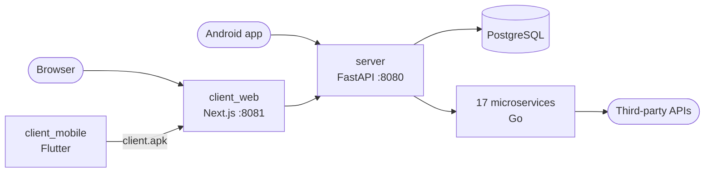

# Area

## Table of Contents

- [Description](#description)
- [Quick start](#quick-start)
- [Configuration](#configuration)
- [Architecture](#architecture)
- [Services](#services)
- [Server API](#server-api)
- [Development without Docker](#development-without-docker)
- [Project Structure](#project-structure)
- [Documentation](#documentation)
- [Known limitations](#known-limitations)
- [Contributors](#contributors)
- [License](#license)

## Description

ActionREAction is an automation platform inspired by services like IFTTT and Zapier. It allows users to create automated workflows (applets) by connecting various services through actions and reactions: *when this happens on service A, do that on service B*.

The platform comprises an application server, a web client, a mobile client and one microservice per third-party service, all orchestrated with Docker Compose. It ships 17 services offering 28 actions and 34 reactions.

## Quick start

> **Note:** you only need Docker with Docker Compose.

```bash
git clone https://github.com/Xylliar/area.git
cd area
docker compose up -d --build
```

The first build takes a few minutes. Then:

| URL | What |
| --- | --- |
| http://localhost:8081 | Web client |
| http://localhost:8080/about.json | Services, actions and reactions supported by the server |
| http://localhost:8080/docs | Interactive API documentation (Swagger) |

Log in with the default administrator account `admin` / `admin`, or register a new account: without an email provider configured, the activation link is printed in `docker compose logs server`.

Actions and reactions that need no account or key work out of the box (Binance, CheckHost, Chess.com, Christmas, Prayer, Time, Discord webhook). For instance, an applet *Time: every day at 08:30* → *Discord: send message with a webhook*.

To stop the project:

```bash
docker compose down        # keeps the database
docker compose down -v     # also deletes the database
```

### Android client

The mobile client is built by the `client_mobile` service, which is opt-in because a Flutter build takes a while:

```bash
docker compose --profile mobile up -d --build
```

The APK is then served at http://localhost:8081/client.apk. The server address can be changed from the app settings.

## Configuration

Every setting is optional. Copy [`.env.example`](.env.example) to `.env` and fill in what you need:

| Variables | Enables |
| --- | --- |
| `SECRET_KEY` | Sessions surviving a restart of the server (a random key is generated otherwise) |
| `RESEND_API_KEY`, `EMAIL_FROM` | Activation and password reset emails, Resend reaction |
| `GOOGLE_*`, `GITHUB_*`, `DISCORD_*`, `SPOTIFY_*`, `TWITCH_*` | Login with Google or GitHub, and the services requiring a linked account |
| `GITHUB_WEBHOOK_URL` | GitHub actions (public URL reaching the github microservice) |
| `BRAWLSTARS_API_KEY`, `OPENWEATHER_API_KEY`, `TWILIO_*` | Brawl Stars, OpenWeather and SMS services |

The OAuth callback URL to register on each provider is `http://localhost:8080/auth/<provider>/callback` (`/auth/google/callback/login` and `/auth/google/callback/link` for Google). Then rebuild with `docker compose up -d --build`.

## Architecture



- **Server** (`backend/`, Python / FastAPI): the only component holding business logic. It manages users and their OAuth tokens, the catalog of services, the applets, and the *hook*: a scheduler that polls the actions of the active applets and triggers their reactions.
- **Web client** (`frontend/`, Next.js / React) and **mobile client** (`mobile_client/`, Flutter): user interfaces on top of the server REST API.
- **Microservices** (`services/images/`, Go): one stateless HTTP worker per service, called by the server with the user inputs, the state of the action and the user's token.

Class and sequence diagrams are in [docs/architecture.md](docs/architecture.md).

## Services

| Service | Actions | Reactions | Needs |
| --- | --- | --- | --- |
| Binance | price rises, price drops | | |
| Brawl Stars | new trophy record, map rotation changed | | API key |
| CheckHost | host unreachable, TCP port unreachable | | |
| Chess.com | rating increased | | |
| Christmas | it is Christmas | | |
| Discord | new message in channel | send message, send message with a webhook, disconnect voice channel, add role, kick member | Discord account (except webhook) |
| GitHub | push, issue, pull request, new branch or tag | create issue, file, pull request, branch | GitHub account, public webhook URL |
| Gmail | | send email, send email to myself | Google account |
| Google Calendar | new event, new event matching a keyword | add event | Google account |
| Google Drive | | append to file | Google account |
| OpenWeather | weather condition, sunrise, sunset | | API key |
| Prayer | prayer time, any prayer time | | |
| Resend | | send email | API key |
| SMS | | send SMS | Twilio account |
| Spotify | new playlist, podcast, album, audiobook | next, previous, pause, resume, repeat, shuffle, add to queue | Spotify account |
| Time | every day at | | |
| Twitch | new follower, clip, blocked user | chat message, announcement, clip, ban/unban, moderator, VIP, block/unblock, whisper | Twitch account |

Each service is documented in [docs/services](docs/services), and declared in [`backend/services_catalog.yaml`](backend/services_catalog.yaml).

## Server API

The server exposes a REST API on port 8080. The complete, interactive reference (request and response schemas) is generated by FastAPI at http://localhost:8080/docs.

Authenticated endpoints expect an `Authorization: Bearer <token>` header, the token being returned by `POST /auth/login` (form fields `username` and `password`). *Admin* endpoints require an account with the `admin` role.

| Endpoint | Auth | Description |
| --- | --- | --- |
| `GET /about.json` | | Client IP, server time and the services with their actions and reactions |
| `GET /health` | | Health check |
| **Authentication** | | |
| `POST /auth/login` | | Get an access token |
| `GET /auth/acces-token-validity` | | Check a token |
| `POST /auth/send-activation-token` | user | Email the account activation link |
| `PATCH /auth/activate?token=` | | Activate an account |
| `POST /auth/send-password-reset-token/{email}` | | Email a password reset link |
| `PATCH /auth/reset-password?token=&password=` | | Reset a password |
| `GET /auth/{google,github}/login` | | Log in with Google or GitHub (OAuth2) |
| `GET /auth/{provider}/link` | user | Get the URL linking a Google, GitHub, Discord, Spotify or Twitch account |
| `GET /auth/{provider}/callback` | | OAuth2 callback, called by the provider |
| `DELETE /auth/{provider}/link` | user | Unlink an account |
| `GET /auth/{provider}/link-status` | user | Whether an account is linked |
| **Users** | | |
| `POST /users` | | Register |
| `GET`, `PATCH`, `DELETE /users/me` | user | Own profile |
| `GET /users`, `GET`, `PATCH`, `DELETE /users/{id}` | admin | User administration |
| **Services, actions and reactions** | | |
| `GET /services`, `GET /services/{id}` | | Services |
| `GET /services/{id}/icon` | | Service icon (SVG) |
| `GET /services/{id}/actions`, `GET /actions`, `GET /actions/{id}` | | Actions, with their input and output fields |
| `GET /services/{id}/reactions`, `GET /reactions`, `GET /reactions/{id}` | | Reactions, with their input fields |
| `POST /services`, `PATCH`, `DELETE /services/{id}`, `PUT /services/{id}/icon` | admin | Manage services |
| `POST /services/{id}/actions`, `DELETE /actions/{id}` | admin | Manage actions |
| `POST /services/{id}/reactions`, `DELETE /reactions/{id}` | admin | Manage reactions |
| **Applets (AREA)** | | |
| `GET`, `POST /users/me/applets` | user | List and create own applets |
| `GET`, `PATCH`, `DELETE /users/me/applets/{id}` | user | Read, enable/disable, edit, delete an applet |
| `POST /users/me/applets/{id}` | user | Copy a public applet |
| `GET /applets`, `GET /applets/{id}` | | Public applets (templates) |
| `POST /applets`, `PATCH`, `DELETE /applets/{id}` | admin | Manage public applets |
| `POST /applets/trigger_reactions/{id}` | | Called by webhook microservices when an event happens |

`GET /about.json` answers:

```json
{
  "client": {"host": "172.18.0.1"},
  "server": {
    "current_time": 1790669312,
    "services": [
      {
        "name": "discord",
        "actions": [{"name": "new_message_in_channel", "description": "New messages were posted in a channel."}],
        "reactions": [{"name": "send_message", "description": "Send a message in a channel with the linked account."}]
      }
    ]
  }
}
```

## Development without Docker

**Server** (Python 3.12 and a PostgreSQL database):

```bash
cd backend
python3.12 -m venv .venv && source .venv/bin/activate
pip install -r requirements.txt
cp .env.example .env    # then set DATABASE_URL
python database_setup.py && fastapi dev main.py --port 8080
```

**Web client** (Node.js 22):

```bash
cd frontend
npm install
npm run dev             # http://localhost:8081
```

The microservices are only reachable on the Docker network: run the whole stack with `docker compose` to test actions and reactions end to end.

## Project Structure

```
area/
├── backend/                 # Application server (FastAPI)
│   ├── routes/              # REST endpoints
│   ├── database_orm/        # SQLAlchemy models
│   ├── runner.py            # Hook: scheduler running the applets
│   ├── services_catalog.yaml# Services, actions and reactions loaded at startup
│   └── config.py            # Environment settings
├── frontend/                # Web client (Next.js)
├── mobile_client/           # Mobile client (Flutter)
├── services/
│   ├── images/              # One microservice per service (Go)
│   └── kubernetes/          # Manifests of the former k3s deployment
├── docs/                    # Architecture, services, deployment
├── docker-compose.yml
└── HOWTOCONTRIBUTE.md       # How to add services, actions and reactions
```

## Documentation

- [docs/architecture.md](docs/architecture.md): components, data model and sequence diagrams
- [HOWTOCONTRIBUTE.md](HOWTOCONTRIBUTE.md): adding services, actions, reactions and OAuth providers
- [docs/services](docs/services): endpoints of each microservice
- [docs/frontend](docs/frontend/README.md): web client
- [docs/k3s](docs/k3s/README.md) and [docs/cicd](docs/cicd/README.md): the Kubernetes (k3s) deployment the project originally ran on

## Known limitations

- Login with Google/GitHub and the services tied to an account need your own OAuth applications (see [Configuration](#configuration)).
- GitHub actions rely on webhooks: GitHub must reach the github microservice through a public URL, e.g. a tunnel, set in `GITHUB_WEBHOOK_URL`.
- The Android build image is x86-64 only; on Apple Silicon it runs through emulation and is slow.

## Contributors

Project completed by a team of six as part of the Epitech program, originally hosted on a private repository at the school

This project was carried out with Alexandre MOLINA, Jules REYNAUD, Axel LONDAS and Tom FACON.

## License

This project is licensed under the MIT License - see the [LICENSE](LICENSE) file for details.
