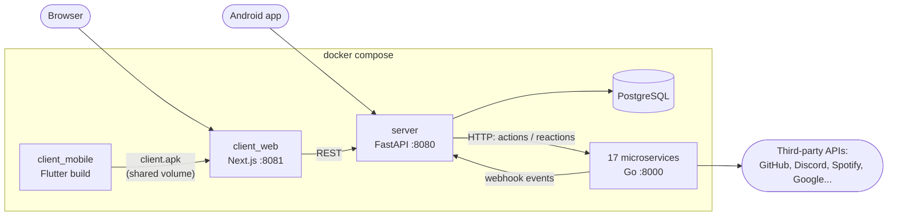
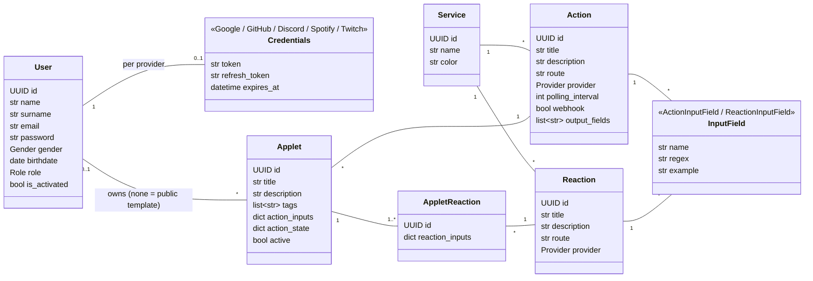
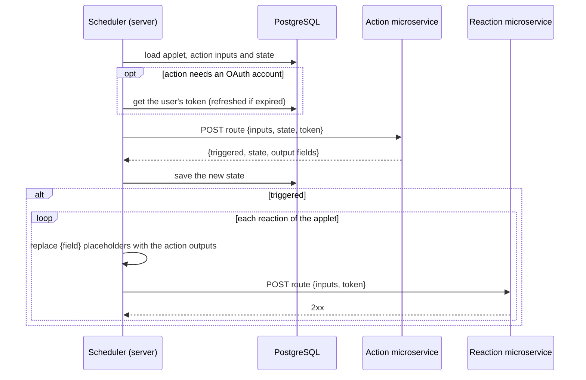
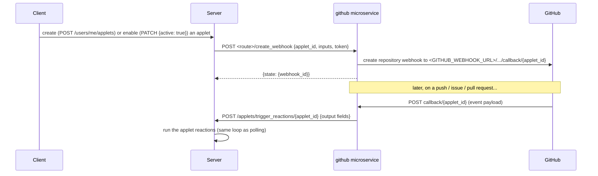
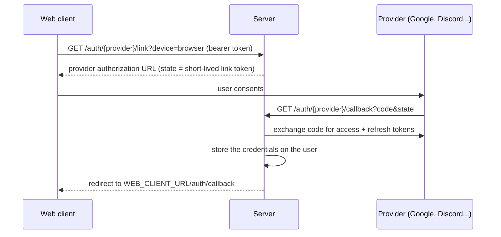

# Architecture

## Components

- **server** holds all the business logic: users, OAuth tokens, the catalog of services, the applets and the
  scheduler (the *hook*) that runs them. It is the only component talking to the database.
- **client_web** and **client_mobile** are pure user interfaces on top of the server REST API.
- **microservices** are stateless workers, one per service. The server calls them with the user inputs, the
  saved state of the action and, when needed, the user's OAuth token; they call the third-party API and answer.

## Data model

An **applet** is an AREA: one action and one or more reactions, each with the values the user typed for its
input fields. `action_state` is opaque data the action microservice returns to remember what it already saw
(last message id, last price...). Reaction inputs may contain `{field}` placeholders, replaced by the action
output fields when the reactions run.

## Hook: polling actions

Most actions are polled. Enabling an applet schedules a job (APScheduler, persisted in the database) that runs
every `polling_interval` minutes.

## Hook: webhook actions

GitHub actions are pushed by GitHub instead of being polled.

## Linking an OAuth account

